<div align="center">



**BOHLALE LEKGAU** &nbsp;·&nbsp; Data Engineer &nbsp;·&nbsp; Johannesburg, South Africa

[](https://github.com/lekgau-bohlale)
[](mailto:lbohlale1@gmail.com)

</div>


```yaml
designation : "Bohlale Lekgau"
function    : "Data Engineer"
focus       : "scalable ETL/ELT pipelines, RAG architectures, governed self-healing data ops"
sector      : "Johannesburg, South Africa"
training    : "Advanced Diploma in IT, Vaal University of Technology (exp. Nov 2027)"
learning    : [ "agentic AI", "Model Context Protocol (MCP)", "LangGraph" ]
directive   : "build smarter, resilient data workflows"
```


**Languages and frameworks**<br/>


**Data engineering**<br/>


**AI and agentic systems**<br/>


**Cloud (AWS) and DevOps**<br/>


**Concepts:** ETL/ELT pipelines · data warehousing · dimensional modelling · data orchestration · data quality testing · slowly changing dimensions · incremental loading


| Qualification | Institution |
|---------------|-------------|
| **Advanced Diploma in Information Technology** (expected Nov 2027) | Vaal University of Technology |
| **National Diploma in Information Technology** | Vaal University of Technology |


> Personal project: **Emergency Personnel Response Platform**, built around South African national roads (SANRAL) data sources. Not affiliated with or endorsed by SANRAL.

### [Governed Self-Healing Traffic Telemetry Lakehouse](https://github.com/lekgau-bohlale)

- Detects pipeline outages, diagnoses root causes and executes governed recovery workflows.
- An MCP agent reads Airflow logs and pgvector embeddings to pinpoint failure causes.
- A tiered remediation engine auto-runs safe fixes (retries, backfills) and routes high-risk changes to a human for approval.


### [i-TRAFFIC Vision-Driven Emergency Dispatch Pipeline](https://github.com/lekgau-bohlale)

- Builds on the lakehouse: pulls camera snapshots from the SANRAL i-TRAFFIC API.
- Detects road incidents with machine vision and alerts a duty officer with the exact location.


<div align="center">


<sub>`> end of transmission`</sub>

</div>
